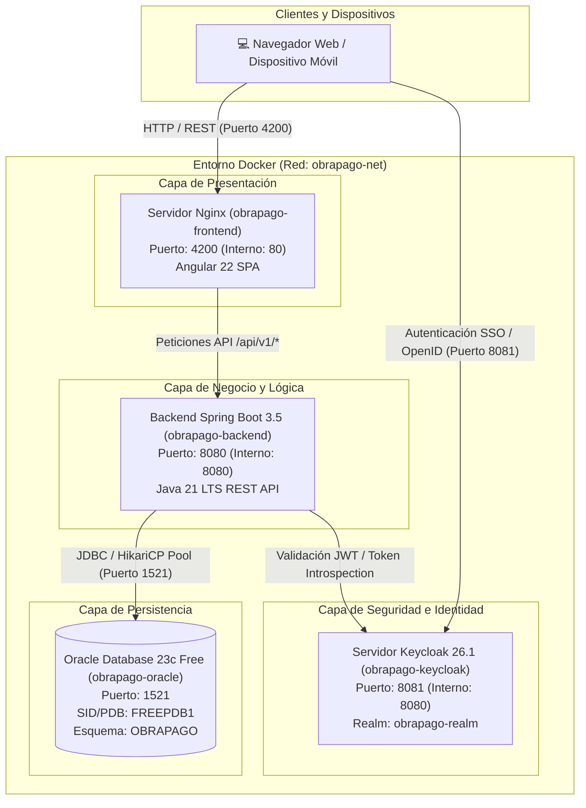
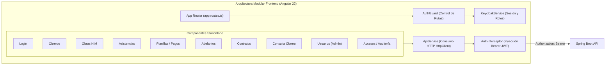
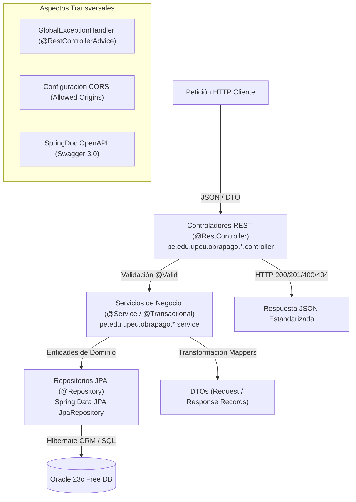
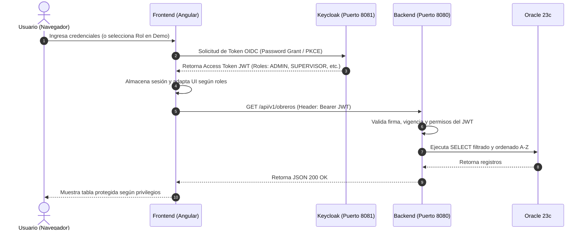
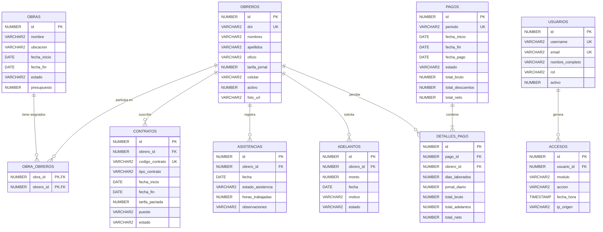

# Documento de Arquitectura de Software: Sistema ObraPago
**Control de Jornales, Asistencia, Obras y Planillas para el Sector Construcción**

---

## 1. Ficha Técnica del Proyecto

| Parámetro | Detalle Técnico |
| :--- | :--- |
| **Nombre del Sistema** | **ObraPago** — Sistema Integral de Control de Jornales y Planillas |
| **Institución / Contexto** | Universidad Peruana Unión (UPeU) / Curso LP2 |
| **Versión del Sistema** | v1.0.0-RELEASE (Producción Contenedorizada) |
| **Arquitectura de Software** | Arquitectura en Capas desacoplada basada en Contenedores Microservicios/Servicios |
| **Lenguaje Backend** | Java 21 LTS |
| **Framework Backend** | Spring Boot 3.5.16 (Spring Data JPA, Spring Web, Spring Validation) |
| **Framework Frontend** | Angular 22.2 (Componentes Standalone, Vite/Application Builder) |
| **Gestor de Identidad (IdP)** | Red Hat Keycloak 26.1 (OAuth 2.0 / OpenID Connect / RBAC) |
| **Base de Datos** | Oracle Database 23c Free (`FREEPDB1`) |
| **Servidor Web Frontend** | Nginx Alpine (Reverse Proxy & Static Web Server) |
| **Orquestación de Infraestructura** | Docker Compose v2 (Red Bridge dedicada `obrapago-net`) |
| **Documentación de APIs** | SpringDoc OpenAPI 2.8.17 / Swagger UI |

---

## 2. Resumen Ejecutivo y Alcance

El sistema **ObraPago** es una solución empresarial de software diseñada específicamente para resolver la alta complejidad operativa de la gestión de mano de obra en el sector de la construcción civil. Entre sus objetivos primordiales se encuentran:

1. **Gestión de Personal Obrero**: Registro maestro de trabajadores con estandarización de nombres en formato `Apellidos, Nombres` y ordenamiento alfabético estricto de la A a la Z.
2. **Asignación Multiobra (N:M)**: Posibilidad de vincular múltiples obreros a distintas obras simultáneamente y gestionar sus cuadrillas.
3. **Control Riguroso de Asistencia**: Registro diario de jornadas laborales (asistencias, faltas, tardanzas y permisos) con cálculo de horas efectivas.
4. **Vales y Adelantos Semanales**: Emisión y control de adelantos de efectivo con amortización y descuento automático en el corte de nómina.
5. **Cálculo y Liquidación de Planillas**: Automatización del cálculo de jornales devengados, deducción de adelantos otorgados y emisión de boletas/detalles de pago neto.
6. **Seguridad Robusta con RBAC**: Control de acceso granular basado en 4 roles definidos en Keycloak (`ADMIN`, `SUPERVISOR`, `PLANILLERO`, `OBRERO`), garantizando que cada participante opere exclusivamente dentro de los límites de sus competencias.

---

## 3. Arquitectura Global del Sistema

El ecosistema se implementa bajo un enfoque de **servicios desacoplados en contenedores Docker**, comunicados mediante una red interna privada virtual (`obrapago-net`) y exponiendo puertos seguros hacia el host anfitrión.



### Detalle de los 4 Contenedores Orquestados

1. **`obrapago-frontend` (Puerto 4200)**:
   - Contenedor ligero `nginx:alpine` que sirve los archivos estáticos de la aplicación Angular compilada en producción.
   - Configuración de cabeceras `Cache-Control: no-store, no-cache, must-revalidate` para garantizar actualización inmediata de la interfaz ante despliegues continuos.
2. **`obrapago-backend` (Puerto 8080)**:
   - Contenedor basado en Eclipse Temurin Java 21 ejecutando el ejecutable `app.jar` de Spring Boot.
   - Aloja la lógica de negocio, validaciones transaccionales, mapeo JPA y controladores REST.
   - Incluye una consola visual interactiva en la raíz `/` con enlaces directos a la documentación Swagger UI y al frontend.
3. **`obrapago-keycloak` (Puerto 8081)**:
   - Servidor Keycloak 26.1 en modo standalone con importación automática de reino (`realm-export.json`).
   - Administra los usuarios (`admin`, `supervisor`, `planillero`, `obrero`), las contraseñas con hash, los roles y la emisión de tokens JWT.
4. **`obrapago-oracle` (Puerto 1521)**:
   - Servidor Oracle 23c Free Slim con base de datos conectable `FREEPDB1`.
   - Almacena de manera persistente las tablas del sistema mediante un volumen Docker (`oracle-data`).

---

## 4. Capa Frontend (Angular 22 Client)

El cliente web ha sido construido bajo los estándares más modernos del ecosistema Angular:



### Características Técnicas del Frontend
- **Arquitectura Standalone**: No utiliza módulos antiguos `NgModule`, lo que reduce el bundle size a solo 512 KB y optimiza el árbol de dependencias con tree-shaking.
- **Intercepción de Seguridad**: Cada petición HTTP dirigida hacia `/api/v1/*` es interceptada por `auth.interceptor.ts` agregando el encabezado `Authorization: Bearer <token>`.
- **Selector Rápido de Rol en Tiempo Real**: En la barra de navegación superior se integró un conmutador de cuentas demo que permite a evaluadores y docentes verificar los límites de los 4 perfiles en vivo sin salir de la pantalla.
- **Estandarización de Datos**: Listados con avatares dinámicos basados en iniciales, badges coloreados por oficio (`OPERARIO`, `OFICIAL`, `PEON`, `MAESTRO`) y ordenamiento alfabético garantizado mediante `localeCompare` en español.

---

## 5. Capa Backend (Spring Boot 3.5 REST API)

El backend implementa una **Arquitectura en Capas Canónica** que garantiza separación de responsabilidades, alta cohesión y bajo acoplamiento:



### Componentes Clave del Backend
1. **Controladores REST**: Responsables de exponer las URLs bajo el prefijo `/api/v1/`, validar los datos con Jakarta Validation (`@NotNull`, `@Size`, `@Min`) y retornar códigos de estado HTTP semánticos (`200 OK`, `201 Created`, `204 No Content`).
2. **Servicios Transaccionales**: Contienen las reglas de negocio críticas, como el cálculo de retenciones, el control de vigencia de contratos, la asignación de obreros a cuadrillas y la liquidación neta de planillas.
3. **Repositorios JPA**: Utilizan la abstracción de Spring Data JPA con consultas automáticas por método y consultas nativas optimizadas para Oracle.
4. **Manejo Centralizado de Excepciones**: `GlobalExceptionHandler.java` intercepta excepciones de negocio (`BusinessException`), recursos no encontrados (`ResourceNotFoundException`) y errores de validación, retornando un objeto `ApiError` estructurado.

---

## 6. Seguridad e Identidad: Keycloak & Matriz RBAC

La autenticación y autorización se rigen bajo el estándar industrial **Role-Based Access Control (RBAC)** administrado centralizadamente por Red Hat Keycloak.



### Matriz de Privilegios por Rol

| Módulo del Sistema | `ADMIN` | `SUPERVISOR` | `PLANILLERO` | `OBRERO (CONSULTA)` |
| :--- | :---: | :---: | :---: | :---: |
| **Ficha Obrero: Ver / Listar** |  Permitido |  Permitido |  Permitido |  **Solo Lectura** |
| **Ficha Obrero: Crear / Editar / Borrar** |  **Control Total** | ❌ Bloqueado | ❌ Bloqueado | ❌ Bloqueado |
| **Obras: Crear y Configurar** |  **Control Total** | ❌ Bloqueado | ❌ Bloqueado | ❌ Bloqueado |
| **Obras: Asignar Cuadrilla (N:M)** |  Permitido |  **Permitido** | ❌ Bloqueado | ❌ Bloqueado |
| **Contratos: Crear y Modificar** |  **Control Total** | ❌ Bloqueado | ❌ Bloqueado | ❌ Bloqueado |
| **Asistencias: Marcar y Guardar** |  Permitido |  **Permitido** | ❌ Bloqueado | ❌ Bloqueado |
| **Adelantos: Emitir y Anular** |  Permitido | ❌ Bloqueado |  **Permitido** | ❌ Bloqueado |
| **Planillas: Generar y Pagar** |  Permitido | ❌ Bloqueado |  **Permitido** | ❌ Bloqueado |
| **Consulta Individual Obrero** |  Permitido |  Permitido |  Permitido |  **Permitido** |
| **Gestión de Usuarios y Accesos** |  **Exclusivo Admin** | ❌ Oculto | ❌ Oculto | ❌ Oculto |

---

## 7. Modelo de Datos y Persistencia (Oracle 23c)

El modelo relacional fue diseñado para preservar la integridad referencial y soportar el histórico de contratos, asistencias y pagos en obras civiles.



---

## 8. Catálogo de Módulos Funcionales

### Módulo 1: Gestión Maestra de Obreros
- **Funcionalidad**: Alta, baja lógica, consulta y modificación de datos personales del trabajador.
- **Estandarización**: Nombres formateados estrictamente como `Apellidos, Nombres` con ordenamiento alfabético de la A a la Z en todas las vistas y reportes.
- **Integración Reniec**: Capacidad de búsqueda automatizada por número de DNI para agilizar el llenado de apellidos y nombres.

### Módulo 2: Obras y Asignación Masiva (Relación N:M)
- **Funcionalidad**: Creación y monitoreo de obras de construcción con asignación dinámica de cuadrillas de obreros.
- **Operación**: Permite agregar o remover obreros de una obra mediante switches interactivos con guardado en lote.

### Módulo 3: Contratos y Régimen Laboral
- **Funcionalidad**: Emisión de contratos temporales o indeterminados con tarifa jornal pactada, fechas de inicio y fin, y control de vencimiento.

### Módulo 4: Jornadas y Control de Asistencia
- **Funcionalidad**: Registro masivo de asistencia diaria por fecha.
- **Estados**: `ASISTIO`, `FALTA`, `TARDANZA`, `PERMISO`, con asignación de horas trabajadas para el cálculo de nómina.

### Módulo 5: Vales y Adelantos de Dinero
- **Funcionalidad**: Registro de anticipos semanales entregados a los trabajadores con motivo y fecha.
- **Liquidación Automática**: Los vales en estado `PENDIENTE` se descuentan de forma transparente al momento de liquidar la planilla quincenal o mensual.

### Módulo 6: Planilla Mensual y Liquidación de Pagos
- **Funcionalidad**: Generación automática de planillas basada en días trabajados registrados en asistencia multiplicados por la tarifa del obrero, restando los adelantos activos.
- **Trazabilidad**: Estados `GENERADA`, `PAGADA` y `ANULADA`.

### Módulo 7: Consulta Individualizada del Obrero
- **Funcionalidad**: Portal de auto-consulta donde cualquier trabajador puede ingresar su DNI y revisar sus contratos vigentes, días asistidos, vales descontados y pagos netos recibidos.

### Módulo 8: Seguridad, Usuarios y Auditoría
- **Funcionalidad**: Monitoreo de actividad del sistema con registro de cada acceso, módulo visitado, dirección IP y fecha/hora.

---

## 9. Endpoints Principales de la API REST

| Método | Endpoint | Descripción | Acceso Permitido |
| :--- | :--- | :--- | :--- |
| `GET` | `/` | Pantalla visual informativa y estado del servidor backend | Público |
| `GET` | `/api/v1/obreros` | Lista todos los obreros ordenados alfabéticamente (A-Z) | Todos los roles |
| `POST` | `/api/v1/obreros` | Registra un nuevo obrero | `ADMIN` |
| `PUT` | `/api/v1/obreros/{id}` | Modifica datos del obrero | `ADMIN` |
| `DELETE` | `/api/v1/obreros/{id}` | Desactiva a un obrero (baja lógica) | `ADMIN` |
| `GET` | `/api/v1/obras` | Lista obras con estado y presupuesto | Todos los roles |
| `POST` | `/api/v1/obras/{id}/cuadrilla`| Asigna cuadrilla de obreros masivamente | `ADMIN`, `SUPERVISOR` |
| `GET` | `/api/v1/asistencias/fecha` | Consulta asistencia de una fecha | Todos los roles |
| `POST` | `/api/v1/asistencias/guardar`| Guarda el parte diario de asistencia | `ADMIN`, `SUPERVISOR` |
| `GET` | `/api/v1/adelantos` | Lista adelantos emitidos | Todos los roles |
| `POST` | `/api/v1/adelantos` | Registra un nuevo adelanto de dinero | `ADMIN`, `PLANILLERO` |
| `POST` | `/api/v1/pagos/calcular` | Calcula la planilla para un periodo | `ADMIN`, `PLANILLERO` |
| `POST` | `/api/v1/pagos/{id}/pagar` | Marca la planilla como pagada | `ADMIN`, `PLANILLERO` |
| `GET` | `/api/v1/consultas/obrero/{dni}`| Consulta consolidada para obrero | Todos los roles |
| `GET` | `/api/v1/accesos` | Reporte de auditoría y accesos al sistema | `ADMIN` |

---

## 10. Guía de Ejecución y Despliegue con Docker

El proyecto está 100% orquestado mediante Docker Compose.

### Requisitos Previos
- Docker Desktop instalado y en ejecución en Windows/Linux/Mac.
- Al menos 4 GB de memoria RAM libre para los contenedores (Oracle + Keycloak + Spring Boot + Nginx).

### Comandos de Despliegue

```bash
# 1. Clonar o ubicarse en la raíz del proyecto
cd d:\lp2g2

# 2. Levantar la totalidad del ecosistema en segundo plano
docker compose up -d

# 3. Verificar que los 4 contenedores estén en estado 'Up' o 'Healthy'
docker ps

# 4. URLs de Acceso Inmediato
# - Sistema Web (Frontend):        http://localhost:4200
# - Backend API & Swagger UI:      http://localhost:8080/swagger-ui.html
# - Consola Central Keycloak:      http://localhost:8081
# - Conexión Oracle Database:      localhost:1521 (Servicio: FREEPDB1)
```

---

## 11. Conclusiones Arquitectónicas

1. **Separación de Responsabilidades y Escalabilidad**: El desacoplamiento entre el cliente SPA en Angular y el API REST en Spring Boot permite escalar cada capa de forma independiente y sustituir o actualizar componentes sin afectar la continuidad operativa.
2. **Seguridad y Confianza**: La adopción de **Keycloak 26.1** centraliza la identidad y elimina la manipulación insegura de contraseñas en bases de datos locales, implementando el estándar internacional **OAuth 2.0 / JWT**.
3. **Robustez Transaccional**: La base de datos relacional **Oracle 23c Free** garantiza integridad ACID en el cálculo financiero de planillas y la amortización de adelantos, evitando descuadres contables.
4. **Portabilidad Total**: La infraestructura descrita en `docker-compose.yml` asegura que el sistema se ejecute de manera idéntica en entornos de desarrollo local, servidores de evaluación académica o infraestructura cloud de producción.
